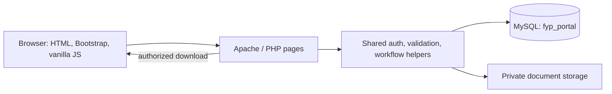

# System design and defense notes

## Purpose and scope

The application maintains an institutional workflow record for final-year project ideas, supervision, documents, reviews, evaluation, approval, and archiving. It does not provide legal intellectual-property protection. The application is an academic prototype and makes no claim to represent confirmed NAUB policy.

## Functional requirements

1. Authenticate users and enforce administrator, Dean, HOD, supervisor, student, and examiner permissions.
2. Maintain a preloaded faculty→department→programme catalogue, academic sessions, deadlines, and evaluation criteria.
3. Let the administrator manage the application globally; let each Dean view their faculty; let each department HOD create supervisor profiles, register students by matric number, and assign departmental supervisors.
4. Register a student idea, maintain its project reference and state, and record coordinator review.
5. Compare project text to stored project text, preserve scores and decisions, and leave approval to a coordinator.
6. Assign supervisors and examiners; constrain staff views and document access to assigned projects.
7. Upload proposal, chapter, final-project, and supporting documents with version history and safe download access.
8. Record supervisor feedback, correction requests, student resubmissions, and meeting notes.
9. Track milestones and show project and submission status.
10. Record examiner scores and comments against configurable criteria, then allow coordinator final approval and archive.
11. Notify users in-app about workflow events and record important actions in an audit log.
12. Search, filter, and print project, workload, submission, and evaluation reports.

## Non-functional requirements

- **Security:** PDO prepared statements, password hashing, session ID regeneration, session timeout, CSRF tokens, server-side access checks, output escaping, upload validation, private storage, and error logging.
- **Usability:** responsive Bootstrap layout, clear status badges, useful error and success feedback, and role-specific navigation.
- **Maintainability:** plain PHP includes and role page folders; no application framework or SPA.
- **Reliability:** relational constraints, transactions for multi-record actions, immutable submission versions, and dated review/assignment history.
- **Performance:** indexes on role/status, department, project/status, submissions, notifications, and audit lookup columns; production-sized lists should be paginated.
- **Compatibility:** PHP 8+, MySQL 8.0+ or MariaDB 10.4+, Apache, and a current browser.

## Roles and main use cases

| Actor | Main use cases |
|---|---|
| Administrator | Manage global accounts, roles, configuration, academic catalogue, sessions, and audit records. |
| Dean | Read-only view of students, staff, supervisors, projects, and activity within their assigned faculty. |
| HOD / Coordinator | Within one department, create supervisors, register students by matric number and programme, assign supervisors, review ideas, inspect advisory similarity matches, set deadlines and criteria, monitor work, assign examiners, approve completion, archive, and print reports. |
| Supervisor | See students assigned by the HOD and their faculty/department/programme, see assigned projects, download submissions, comment, request corrections, approve/reject versions, record meetings. |
| Student | Sign in with matric number, complete contact profile, register an idea, upload versioned documents, download own project documents, see academic registration, assigned supervisor, feedback, progress, deadlines, meetings, and notifications. |
| Examiner | See assigned projects and approved final documents, submit configured criterion scores and evaluation comments. |

## Architecture and data flow

The browser sends HTTP requests to server-rendered PHP pages. Shared include functions establish sessions, check roles, validate CSRF tokens, escape output, and use PDO to read/write MySQL. Submitted documents are checked and moved into a sibling storage directory outside the public web root; database rows hold safe generated names and metadata. Downloads pass through `download.php`, which checks the signed-in user's project access and applies the examiner final-document restriction.

## Database entities and keys

Every table uses an auto-increment primary key unless identified as a composite key. Foreign keys restrict deleting referenced academic or user records; owned history such as project submissions cascades only when the parent project itself is removed. Operationally, projects and audit records should be archived rather than deleted.

| Entity/table | Purpose and relationships |
|---|---|
| `roles` | One role to many users. Role names are unique. |
| `system_settings` | Key/value configuration for portal identity and operational limits; each change records the updating administrator and timestamp. |
| `users` | Accounts; belongs to one role and optionally one department/programme. Email, matric number, and staff number are unique. |
| `faculties` | Preloaded academic grouping; one faculty to many departments. |
| `departments` | Belongs to a faculty; one department to many programmes and project records. |
| `programmes` | Belongs to one department; has many users and projects. |
| `academic_sessions` | Session windows; one session to many projects, deadlines, and scoped evaluation criteria. |
| `projects` | Institutional project record; belongs to department, programme, and session; has a unique reference number and lifecycle status. |
| `project_members` | Many-to-many link between projects and student users, with leader/member role. Composite primary key `(project_id, student_id)`. |
| `project_ideas` | One project to many idea submissions/revisions; stores submitter and coordinator review. |
| `project_similarity_checks` | Each comparison references both the subject and compared project, plus reviewer and algorithm version. |
| `project_supervisors` | Assignment history links projects and supervisor users; ended timestamp preserves reassignment history. |
| `student_supervisors` | HOD assignment history connects student users to supervisor users before project idea registration; ended timestamp preserves reassignment history. |
| `submissions` | One project to many logical document submissions, identified by document type and student. |
| `submission_versions` | One submission to many immutable version/file metadata records. |
| `submission_reviews` | One version to many supervisor decisions/comments. |
| `corrections` | Correction tasks created from a review and assigned to a student. |
| `milestones` | One project to one row per milestone key; status drives project progress. |
| `deadlines` | Session and optional department scoped due dates, created by a coordinator. |
| `supervision_meetings` | Many meeting records per project and supervisor. |
| `examiners` | One-to-one extension of an examiner user account. |
| `project_examiners` | Many-to-many project/examiner assignment, with status and due date. Composite primary key `(project_id, examiner_id)`. |
| `evaluation_criteria` | Configurable criteria, maximum score, weight, evaluator role, and optional session scope. |
| `evaluations` | One project/evaluator evaluation record; unique per project and evaluator. |
| `evaluation_scores` | One score per criterion in an evaluation; unique `(evaluation_id, criterion_id)`. |
| `notifications` | One user to many in-app notifications; nullable `read_at` marks unread state. |
| `audit_logs` | Append-oriented action history; user may be null if the account is later removed. |

### Relationship cardinalities

- **One-to-many:** role→users; faculty→departments; department→programmes; session→projects; project→ideas/submissions/milestones/meetings/evaluations; submission→versions; version→reviews; user→notifications/audit records.
- **Many-to-many with assignment history:** students↔supervisors through `student_supervisors`; projects↔students through `project_members`; projects↔supervisors through `project_supervisors`; projects↔examiners through `project_examiners`.
- **One-to-one:** user↔examiner profile for examiner accounts.
- **Evaluation scoring:** evaluations↔criteria is many-to-many through `evaluation_scores`.

The authoritative DDL and seed data are `database/schema.sql` and `database/seed.sql`.

## Workflow and state progression

Administrator configures the system → HOD creates supervisor profiles and registers students by matric number and programme → HOD assigns each student to a supervisor → student signs in using matric number and the shared development temporary password `password`, changes it, and completes their profile → student submits project idea → HOD reviews idea → proposal and chapters submitted/reviewed/corrected → final project submitted and approved by the supervisor → HOD assigns examiner(s) → examiner evaluations submitted → HOD final approval → completed → archived. A preassigned student supervisor is linked to the project automatically when the idea is registered. Dean access is read-only and limited to their assigned faculty. Similarity results remain advisory.

The similarity check is review assistance only. Completion is server-gated by an approved final project and at least one assigned examiner with all assigned evaluations submitted. Correction and earlier file versions remain available.

## Security controls and limits

- Passwords use PHP `password_hash()`/`password_verify()`; initial accounts require password change.
- Sessions use strict mode, HttpOnly/SameSite cookies, regeneration after sign-in, 30-minute idle timeout, active-account recheck, and role authorization.
- State-changing forms carry per-session CSRF tokens. Text is escaped on output with `htmlspecialchars`.
- User values are passed to PDO prepared statements. Query structure is fixed in application code.
- Uploads restrict extension/MIME/size, use generated filenames, store outside the web root, and check role/project access before download. Examiner downloads are restricted to approved final-project submissions.
- Friendly errors are shown; PHP errors are logged and display is disabled by default.
- The local demo still requires HTTPS, strong operational credentials, backups, rate limiting, server hardening, malware scanning, and a security review before any real deployment. No email password reset or multi-factor authentication is included.

## Verification checklist

Run these checks after importing the database and before a demonstration:

- [ ] Each seeded role can sign in, is forced to change the development password, and can sign out.
- [ ] Incorrect password, inactive account, idle timeout, and role mismatch are handled safely.
- [ ] Student cannot open administrator/coordinator URLs or another student's records.
- [ ] Supervisor cannot open a project that is not assigned to them.
- [ ] Examiner cannot open an unassigned project or download an unapproved/non-final document.
- [ ] Student can register an idea once; required fields and session/department/programme are checked.
- [ ] HOD registers a student with a unique matric number and academic programme, then assigns a same-department supervisor.
- [ ] Student signs in with matric number, must change the temporary password, and completes their profile.
- [ ] Supervisor sees assigned students' faculty, department, programme, and project information.
- [ ] HOD can only view/manage records in their assigned department.
- [ ] HOD can approve/reject/return an idea, run similarity check, and manage supervisor assignment.
- [ ] Similarity comparisons are recorded and do not automatically alter approval.
- [ ] Upload valid PDF/DOC/DOCX, reject oversized/invalid files, retain versions, and enforce authorized downloads.
- [ ] Supervisor can comment, request correction, approve/reject, and student can view feedback and resubmit.
- [ ] Meeting records, milestones, deadlines, and in-app notifications display correctly.
- [ ] Coordinator can assign examiner(s) only after final supervisor approval and configure criteria.
- [ ] Examiner can enter bounded criterion scores and comments; no grade conversion is applied.
- [ ] Coordinator final approval is blocked until final document and all examiner evaluations are complete; completed project can be archived.
- [ ] Admin can create/deactivate accounts and inspect audit records.
- [ ] Search/filter and printable reports remain readable on desktop and mobile.
- [ ] CSRF-protected form submission fails when token is missing or invalid.

## Known implementation limitations

The local XAMPP database now contains the user-confirmed five-faculty, 24-department, 31-active-programme catalogue. Mathematics is an active programme in the Faculty of Natural & Applied Sciences under the Mathematics department. Programme names and department assignments follow the user's confirmed list. There is no email/SMS service, forgot-password delivery, document malware scan, full search/pagination, bulk student import, or production deployment configuration. Confirm local academic policy and validate all records with the institution before presenting the prototype as an official university system.
